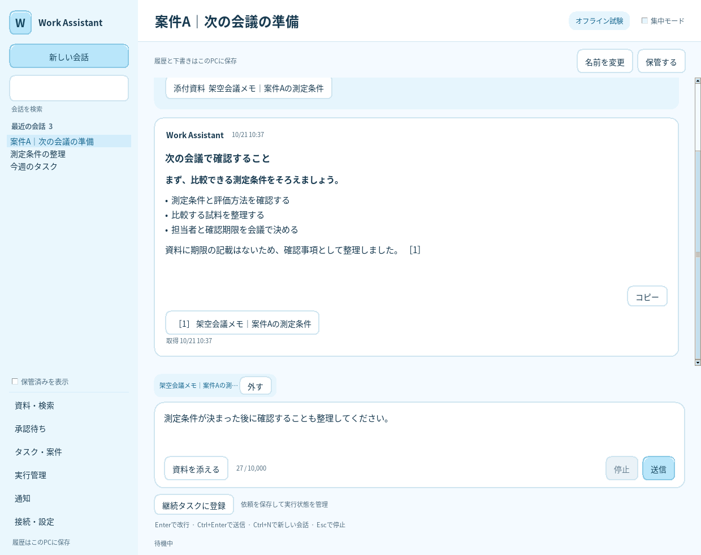
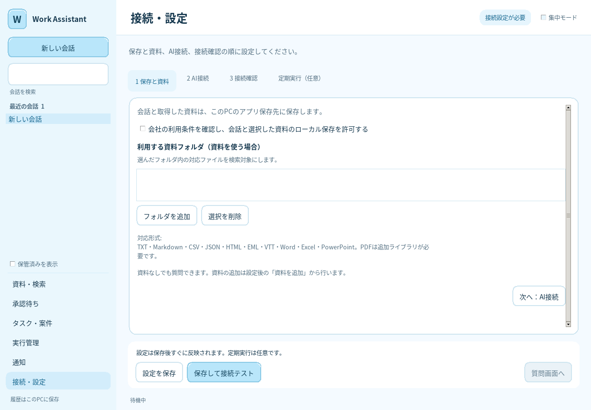

# AI-Agent / Work Assistant

**Windows PCで動く、読み取り中心の業務アシスタント。** Amazon Bedrockを使い、継続タスク・待機と再開・役割別の記憶・定期確認・根拠付きの候補作成を実装しています。

> **実環境での検証が必要な実装です。** ローカル/モックテストは実施していますが、会社テナントの権限、Windows実機、実Bedrock、Power Automateのフローはこのリポジトリだけでは検証できません。初期状態は収集・クラウド推論・定期通知を無効化しています。会社の承認後に必要な機能だけ有効化してください。

> **GitHub反映済み:** 実装一式を`main`へ登録しました。Chrome・Edge共通拡張は[導入手順](extension/README.md)、現在の完成度と入力画面の説明は[コードレビュー](docs/READINESS_REVIEW.md)を参照してください。

## 最初に読むもの

- [継続実行アーキテクチャの評価](docs/ARCHITECTURE_REVIEW.md) — Dots/Grok Bot/OpenClawの解説との比較、実装した構造と試験。
- [継続タスク・定期実行・記憶の使い方](docs/DURABLE_WORK.md) — 画面とCLI、役割・権限、設定、v0.3.0への移行。
- [詳細設計](docs/DESIGN.md) — 実装より先にコミットした構成・データ契約・安全境界。
- [会社PCのCodexへの依頼文](docs/COMPANY_CODEX_PROMPT.md) — 実行、PASS/FAIL判定、失敗時の修正・代替を含む引き継ぎ。
- [実装・検証状況](docs/IMPLEMENTATION_STATUS.md) — 実装したものと、未検証・未対応の区別。
- [OpenClawから取り入れたこと](docs/OPENCLAW_ANALYSIS.md) / [セキュリティ](docs/SECURITY.md)。
- [Power Automateの組み方](power_automate/README.md) — 標準コネクタ、定義ドラフト生成器、8種類のフロー仕様。

## 構成

```text
Teams / Outlook / SharePoint
        │ 標準Power Automate（会社で構築・検証）
        ▼
Box / OneDrive 専用受渡フォルダ ──→ 正規化・重複排除 ──→ ローカルSQLite
                                                              ↑       ↕
Box / OneDrive / SharePoint同期フォルダ ──→ 許可した資料のみ ───┘   自作Agent
                                                                      ↕
Chrome / Edgeで文章を確認 → Native Messaging → ローカル受信箱   Bedrock OpenAI / Claude
                                                                      ↕
                                                        デスクトップUI / CLI
```

同期経由の追加取得は非同期。対話は既存のローカル情報と、Chrome・Edgeから直接渡した文脈を優先します。独自Graphアプリ、Docker、WSL、外部公開HTTPサーバー、OpenClaw本体は必須ではありません。

## 実装されている機能

| 領域 | 内容 |
|---|---|
| 対話 | BedrockのOpenAI Responses / Claude Converse、クライアント側ツール、reasoning項目の引き継ぎ、出典と鮮度、回数/文脈/使用量上限 |
| 継続タスク | SQLiteの状態機械、チェックポイント、時刻/子タスク/追加取得/資料変更の待機、リース回復、再試行、版付き成果物 |
| 役割と記憶 | 永続化された役割、親より広がらない権限、役割別の記憶、FTS5と任意のローカル埋め込み、会話/作業の要約 |
| 自動実行 | 定期実行・1回の時刻指定・イベント、重複排除・debounce、案件と変更からの調査候補、実行履歴と品質評価 |
| 読み取り | 許可フォルダのTXT/MD/CSV/HTML/EML/VTT、Office Open XMLの文字、追加ライブラリ利用時のPDFテキスト |
| 検索 | SQLite FTS5と日本語二文字単位の索引。クラウド埋め込みへの無断送信なし |
| 案件と記憶 | ユーザー定義の案件・目的・キーワード、原文引用付き候補、人の承認後の決定/記憶/タスク |
| 先回り | 朝夕の確認、会議前、会議記録の到着、承認済期限、案件キーワードに関連する新情報 |
| 通知制御 | 曜日/時間帯、集中モード、回数制限、cooldown、再起動をまたぐ重複抑制。何もなければ推論しない |
| ブラウザ | 明示操作時のみプレビュー、選択文または表示本文をローカルへ。Cookie/入力欄の収集なし |
| M365接続 | JSON受信、非同期取得依頼、ID照合、期限、再配送・訂正・削除・失効への対応。クラウドフロー自体は会社で構築 |
| 診断 | オフライン診断と、架空nonceを使う実Bedrockツール往復テスト |

**メール送信・削除・任意コマンド実行・勝手な権限変更は機能として持たせていません。** 自分以外が主催するTeams会議の取得権限や通知範囲は個別に検証します。

## 起動（まず架空データで）

Python 3.11以上。標準ライブラリだけで基本機能とテストが動きます。

```powershell
git clone https://github.com/mugi0227/AI-Agent.git
cd AI-Agent
py -3.11 -m venv .venv
.\.venv\Scripts\python.exe -m pip install --no-build-isolation -e .
.\.venv\Scripts\python.exe -m unittest discover -s tests -v
.\.venv\Scripts\python.exe -m work_assistant demo
.\.venv\Scripts\python.exe -m work_assistant init
.\.venv\Scripts\python.exe -m work_assistant gui
```

`demo`は一時フォルダの架空情報のみ。モデルには接続しません。GUIは会話一覧を左、会話と入力欄を中央に置き、資料検索・承認待ち・タスク/案件・実行管理・通知・接続設定へ移動できます。ウィンドウを閉じると、そのGUI内の常駐処理も終了します。CLI常駐は`python -m work_assistant run`、終了はCtrl+C。同じユーザー・保存先を使うプロセス間の実行権はSQLiteで管理します。DBを共有ネットワークドライブに置かないでください。

PowerShellのExecutionPolicyや会社の制御は変更しません。Pythonバージョン/パッケージ配布に制限がある場合は会社の承認済み経路を使用します。

## AIへの指示はどこから入力する？

v0.3.2では、明るいサイドバー、白いパネル、角丸のボタン・入力欄・設定タブへ統一しています。日本語入力やキー操作にはTkの標準部品を使い、追加のUIライブラリは不要です。[デザイン方針と確認項目](docs/UI_DESIGN.md)を参照してください。

v0.4.0ではClaudeに対応し、「接続・設定 → 2 AI接続」の「モデル一覧を取得」からAWSの対応モデルを選べます。選択するとモデルIDと接続先を設定し、保存後は再起動せず反映します。[モデル選択・利用状態・必要な権限](docs/BEDROCK_MODELS.md)を参照してください。

v0.4.1では白と水色を基調に、主ボタンとロゴの控えめな光沢、濃い青の文字、淡い青の選択表示へ統一しました。会話・設定・実行管理・各ダイアログに同じ配色を使用します。

`python -m work_assistant gui`でデスクトップアプリを開きます。未設定なら初期設定画面が表示されます。設定後、会話画面下部の複数行入力欄へ「案件Aについて、取得済み資料から次の確認事項を整理して」のように入力します。**Enterは改行、Ctrl+Enterまたは「送信」で送信**です。日本語の変換確定で送信しない設計です。

- 会話の新規作成・切替・名前変更・検索・保管/復元。会話ごとの履歴・下書き・選択資料を復元します。
- 「資料を追加」で許可フォルダ内のファイルを取り込みます。「資料を添える」で取得済み資料を最大6件選び、質問する資料を指定できます。出典は番号と資料名で表示し、原文を確認できます。
- 応答を逐次表示し、確認中の状態を表示します。「停止」/Esc、失敗後の再実行、質問の編集、回答と出典のコピーに対応します。
- 待機・再開を含む仕事は「継続タスクに登録」から登録し、「実行管理」で状態・結果・成果物を確認します。定期実行と役割ごとの記憶も操作できます。



詳しくは[会話画面の使い方とOpenClawとの対応](docs/CHAT_UX.md)を参照してください。資料検索は接続なしでも使えますが、AI応答にはBedrockの承認・認証・モデル設定が必要です。CLIの`python -m work_assistant ask "依頼内容"`も利用できます。拡張内チャット、Web/スマホ画面、音声入力、Teams/Slackからの指示受付は未実装です。

## 設定

初回はアプリ内の「接続・設定」で、次の順に進めます。設定ファイルの直接編集は不要です。

1. **保存と資料**: 会社の利用条件を確認してローカル保存を許可し、必要なら資料フォルダを選択。
2. **AI接続**: 会社指定の地域・モデルID・認証方式を入力し、送信と処理地域の許可を確認。AWSプロファイル/SSO、またはAPIキーを登録した環境変数を使用します。キー本体をアプリへ保存しません。
3. **接続確認**: 「保存して接続テスト」を実行。業務資料を使わず、最大2回の有料AI呼び出しで応答とツール呼び出しを確認。
4. **質問画面へ**: 質問を入力。「資料を追加」で許可フォルダ内のファイルを選ぶと、取り込んだ資料を質問に添えられます。



設定は保存後、このアプリに再起動なしで反映します。回答・取り込み・継続タスクの処理中は設定を変更せず、完了後に再試行できます。入力エラーや保存失敗でも入力と元の設定を保持します。定期実行は任意のタブで設定します。

既定の保存先は **`%LOCALAPPDATA%\WorkAssistant`**。高度な連携項目のサンプルは`config.example.json`。GUIにない項目をファイルで変更した場合や、別に起動したCLIプロセスには再起動が必要です。DBは同期フォルダに置かないでください。品質ゴールと検証範囲は[初期設定の完了条件](docs/SETUP_ACCEPTANCE.md)を参照してください。

承認後に設定するもの:
- `local_data_approved`と`roots`（読むフォルダの完全なパス）。最初は小さな専用検証フォルダ。
- `drop_folders`（PAから受け取るJSON）、`outbox`と`bridge_enabled`（追加取得の依頼を出す場合）。
- `allowed_web_hosts`と`extension_ids`（Chrome・Edgeキャプチャを使う場合）。
- `bedrock.enabled`、`data_transfer_approved`、モデル・endpoint・認証・処理地域。定期推論は別途`heartbeat_enabled`。
- 継続タスクと登録した定期実行の自動起動は`durable_work_enabled`。既定は無効。`background_workers`は既定2枠で、対話用の1枠を別に確保します。
- 意味検索を使う場合だけ`memory_embedding_model`へ既存のローカルモデルを指定します。未設定時も全文検索が使えます。

クラウドから取得した情報は既定24時間で再確認が必要です。再確認フローがなければ期限後は利用を停止します。原文が失効/改訂した場合、以前の抽出候補や会話キャッシュも保守的に失効させます。これは完全なリアルタイム権限追従ではありません。

### BedrockでOpenAI・Claudeを使う

OpenAI本家のAPIキーや`api.openai.com`には接続しません。**OpenAI互換のResponses形式を、Bedrockエンドポイントに送信**します。

ClaudeはBedrockのConverse / ConverseStreamへ自動で切り替えます。Claudeの接続先は `https://bedrock-runtime.<地域>.amazonaws.com`、モデルは対応する基本モデルIDまたは地域別・global推論プロファイルIDです。一覧から選ぶと両方が設定されます。会社の認証・モデル利用権限は事前に用意し、選択後に「保存して接続テスト」で確認してください。

| 設定候補 | runtime | Mantle |
|---|---|---|
| base URL | `https://bedrock-runtime.ap-northeast-1.amazonaws.com/openai/v1` | `https://bedrock-mantle.us-east-1.api.aws/openai/v1` |
| モデルID | `global.openai.gpt-6-luna` | `openai.gpt-6-luna` |
| 注意 | 東京受付でもglobal推論。処理地域の承認必須 | このモデルの対応地域と専用base pathを確認 |

上記は2026-10-16のAWSモデルカードを基にした候補で、会社アカウントでの提供・権限を保証しません。設定が合わない場合でも、別モデル/地域/プロバイダーに自動切替しません。

SigV4は承認されたAWSプロファイル/SSOと追加のboto3を利用。APIキー方式は`auth: "api_key"`、キーは`AWS_BEARER_TOKEN_BEDROCK`等の指定環境変数へ。秘密値をconfig.jsonやリポジトリへ書かないでください。すべてのResponses呼び出しで`store:false`を明示しますが、会社/AWS側の別の監査ログ設定を無効にする意味ではありません。

```powershell
# 追加依存は社内承認のある場合だけ
.\.venv\Scripts\python.exe -m pip install --no-build-isolation -e '.[sigv4,pdf]'
.\.venv\Scripts\python.exe -m work_assistant doctor
# 送信と処理地域の承認・認証設定後のみ。架空nonceによる有料の2往復以内の試験
.\.venv\Scripts\python.exe -m work_assistant doctor --live
```

## Chrome・Edge連携

両ブラウザで同じ`extension/`を読み込み、各ブラウザの拡張IDと許可ホストを本体設定へ登録します。Chromeは`scripts/register-native-host.ps1 -Browser Chrome ...`、Edgeは`-Browser Edge ...`でHKCUのNative hostを登録します。登録・解除と許可元manifestはブラウザごとに独立しています。詳しいコマンドは[拡張の導入手順](extension/README.md)を参照してください。既存Windows .NET Frameworkコンパイラによる固定用途リレーが必要です。

拡張のPing→選択文プレビュー→保存を試します。保存はローカルへの転送で、そこから自動的にBedrockへ即時送信するものではありません。アプリの検索・対話・定期確認が、許可設定に基づいて使用します。自律的なサイト巡回やページの自動クリックは初版に含みません。

## 重要な限界

Windows実機と会社M365/Box/Bedrockでの結合試験は未実施です。Power Automateは仕様と定義ドラフトを提供しており、デザイナーでの接続設定・保存・実行が必要です。メール/Teams全履歴、OCR、暗号化文書、画像解析、任意ブラウザ操作、Windowsトースト通知、24時間稼働は未対応です。通知はアプリ内の通知タブに表示します。

既存の業務資料のコピーには会社の保存・転送・保持期間の規定が適用されます。自作だから自動的に安全/承認済みになるわけではありません。

## 開発

`python -m unittest discover -s tests -v`、`python -m compileall -q work_assistant`、`node --check extension/popup.js`。GitHub ActionsにWindows/Linux・Python3.11/3.13のテストを定義しています。実クラウド認証はCIに入れません。

一次資料と参照コミットは[詳細設計](docs/DESIGN.md)と[OpenClaw分析](docs/OPENCLAW_ANALYSIS.md)を参照してください。
