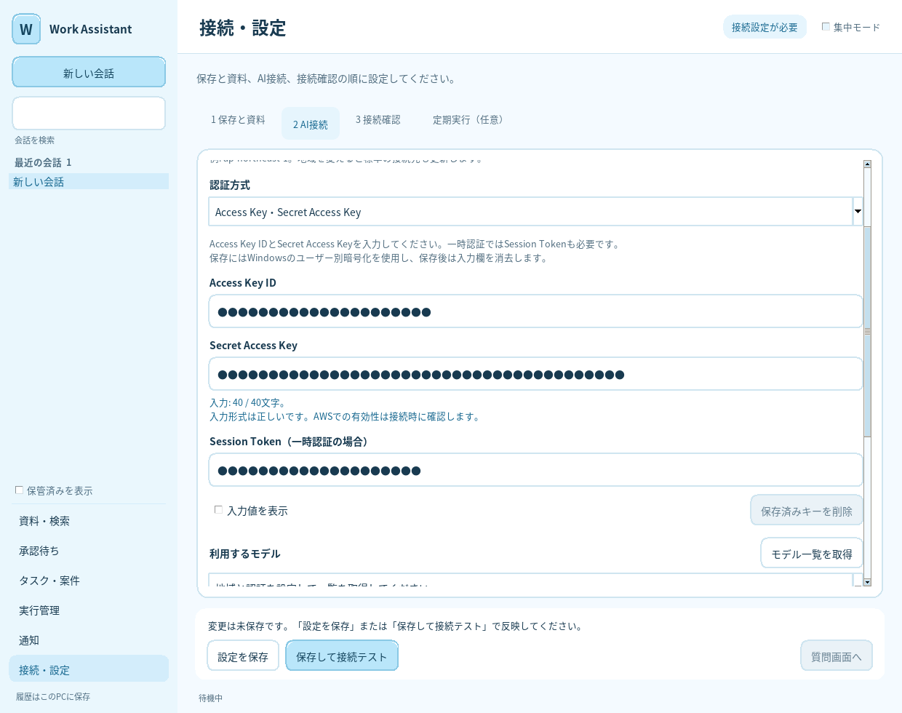

# Access Key・Secret Access KeyによるBedrock接続

v0.5.1 / 2026-10-23。Windowsのデスクトップ画面で認証情報を入力できる。

## 操作

1. 「接続・設定 → 2 AI接続」で、認証方式に「Access Key・Secret Access Key」を選ぶ。
2. Access Key IDとSecret Access Keyを入力する。一時認証の場合は同時に発行されたSession Tokenも入力する。ASIAで始まるIDはTokenが必須。
3. AWSの地域を指定して「モデル一覧を取得」を押し、使用するClaude／OpenAIモデルを選ぶ。一覧取得では入力した認証情報をメモリ上で使用し、設定・キーの保存やAI推論は行わない。
4. 「保存して接続テスト」で保存し、合成文字列による最大2回の有料推論とローカルツールの往復を確認する。「設定を保存」だけなら推論しない。

Secret Access Keyの下には「入力: 40 / 40文字」のように文字数と入力形式を表示する。40文字でも全角・途中の空白・不可視文字・引用符などが混ざると使用できない。前後の空白・改行だけを除いて使用し、大文字小文字や全角文字の自動変換、途中の文字の削除は行わない。キーの形式チェックは通信前に行うため、この段階のエラーには社内プロキシは関係しない。形式が正しくても、AWS上のキーの有効性とIAM権限は接続時に確認する。

図は架空の認証情報を使った実Tk画面。実AWSアカウントの認証・接続を確認した結果ではない。

署名には既存の追加依存 `sigv4`（boto3/botocore）を使用する。会社の配布手順で導入する。モデル一覧の参照権限、モデル利用権限、送信・処理地域の許可は[モデル選択の説明](BEDROCK_MODELS.md)と同じ。キーの入力で権限や利用申込みを変更しない。

## 保存・更新・削除

- 入力欄は初期状態でマスクする。「入力値を表示」で一時的に確認できる。認証方式の切替・保存成功・アプリ終了時には再度マスク／入力消去する。
- WindowsのDPAPIで、現在のWindowsユーザーに紐づけて暗号化する。暗号化データだけをアプリ保存先の `credentials/<識別子>.bin` に置く。設定ファイルには `bedrock.credential_ref` というランダムな参照IDだけを保存する。
- Access Key ID・Secret Access Key・Session Tokenを設定JSON、DB、会話、診断結果、監査ログに保存しない。入力値と署名に必要な復号後の値はプロセスのメモリ上で使用する。
- 次回起動時は同じWindowsユーザーで復号する。画面には保存済みの値を読み戻さず、「保存済み」と表示する。空欄のまま保存済みキーを使用できる。
- 認証方式をプロファイルやAPIキーへ切り替えただけでは、保存済みのAccess Keyは削除しない。削除するときはAccess Key方式の「保存済みキーを削除」を使用する。
- 更新時はAccess Key IDとSecret Access Keyを両方入力する。Tokenを空欄で更新すると、古いTokenを引き継がず空にする。一時認証の自動更新は行わないため、有効期限後は新しい一組を入力する。
- 「保存済みキーを削除」は、次の「設定を保存」で反映する。削除後は再入力するまでこの認証方式で接続できない。AWS上のキー自体を無効化する機能ではない。
- 暗号化／設定保存が失敗した場合は元の設定とキーを維持し、画面の入力を残して再試行できる。設定を先に切り替えてから古い暗号化ファイルを整理し、削除失敗は画面に表示する。次の保存で整理を再試行する。
- 同じ保存先を使う複数プロセスの設定書き込みをファイルロックで直列化し、別プロセスが更新したキー参照を古い設定で上書きしない。

DPAPIによる保存はWindows限定。Linux等で平文ファイルに切り替える処理はない。そこでは従来のAWSプロファイル・環境変数を使用できる。WindowsユーザーやPCを変えた場合も、必要に応じて再入力する。DPAPIは同じOSユーザーの悪意あるプログラムからの隔離ではなく、削除も媒体上の物理的な安全消去を保証しない。

## 認証経路と検証

直接入力したキーはAWS SigV4署名に使用する。Claude Converse/ConverseStream、OpenAI Responses、AWSカタログのGET要求に共通の認証経路を適用する。Access Key方式ではAWSプロファイル・環境変数・メタデータから別の認証情報を探すフォールバックを行わない。

キーの形式、Tokenの不足、秘匿情報を含まないエラー、署名のHMAC、GET/POST、両モデルAPI、保存・再読込・更新・削除、保存失敗のロールバック、複数プロセスの競合、実Tkの入力・一覧取得・保存・接続テストを架空のキーで検証する。Windows CIではDPAPIを実行し、長いTokenの往復と異なる追加エントロピーでの復号拒否を試験する。実際の会社キーによるBedrock接続は、会社PCの接続テストで確認する。

DPAPIの仕様: [CryptProtectData](https://learn.microsoft.com/en-us/windows/win32/api/dpapi/nf-dpapi-cryptprotectdata)。

## 社内ネットワークと接続エラー

「接続・設定 → 2 AI接続 → 接続先・プロキシ・証明書・利用上限を表示」で設定する。

- **社内プロキシURL**: 社内ITが指定する `http://proxy.example:8080` などを入力する。HTTPSのBedrockへ接続する場合でも、プロキシURLは通常 `http://` から始まる。指定値はモデル一覧取得・推論・接続テストに共通で使用する。空欄はPython urllibの標準動作（HTTPS_PROXYなどの環境変数、Windowsの静的なプロキシ設定）に従う。NO_PROXYなどの除外設定も適用される。
- **会社のCA証明書ファイル**: TLS検査を行う会社では、社内ITが配布するPEM形式のCA証明書ファイルを指定する。空欄はOS・Pythonの既定の信頼設定を使用する。証明書の検証は常に有効にする。
- **PAC・統合認証**: ブラウザの自動構成PACを実行したり、ブラウザのNTLM／Kerberos等の認証を自動で引き継いだりする機能はない。PACのURLはプロキシURLとして指定できない。407の場合は、会社で許可されたPython向け接続方法・接続先の例外設定を社内ITに確認する。ID・パスワード付きURLは保存しない。
- **AWSプロファイル・SSO**: 画面のプロキシURLはBedrock HTTP通信の設定。boto3が行うSSOやSTSの認証更新には、別途AWS SDK側の社内プロキシ・CA設定が必要な場合がある。直接Access Key方式ではSSOへの切替や自動更新を行わない。

| 表示・エラーコード | 確認すること |
|---|---|
| `AWS_SECRET_ACCESS_KEY_LENGTH` | 文字数。通信はまだ行っていない |
| `AWS_SECRET_ACCESS_KEY_INVALID` | 全角・空白・不可視文字などの文字種。40文字でも該当する |
| `BEDROCK_PROXY_AUTH_REQUIRED`（407） | 社内プロキシの認証。AWSキーの認証とは別 |
| `BEDROCK_PROXY_BLOCKED` | CONNECT先をプロキシが403で拒否した。社内ITへ通信許可を確認 |
| `BEDROCK_CA_BUNDLE_INVALID` | PEMファイルの形式・存在・読み取り権限 |
| `BEDROCK_TLS_CERTIFICATE` | 会社のCA・PCの日時・接続先の証明書 |
| `BEDROCK_DNS_FAILED` / `BEDROCK_TIMEOUT` | 社内ネットワーク・VPN・プロキシ名・ファイアウォール |
| `BEDROCK_ACCESS_DENIED` | HTTP 401/403。AWSキー・Tokenの期限・IAM・モデル権限を確認。通信経路上のゲートウェイが403を返す場合もある |

一覧取得の接続先は `bedrock.<地域>.amazonaws.com`、推論は設定に従い `bedrock-runtime.<地域>.amazonaws.com` または `bedrock-mantle.<地域>.api.aws`。一覧だけ成功／推論だけ失敗する場合は、各ホストへの通信許可と、それぞれのIAM権限を確認する。エラーにはプロキシ・AWSの応答本文や入力したキーを表示しない。

社内Codexには、キーの値を渡さず、Pythonプロセスから見えるプロキシ設定、PACの有無、承認済みCAの場所と上表のエラーコードを確認させる。実際の社内プロキシ・AWS接続はこの開発環境から検証していない。
