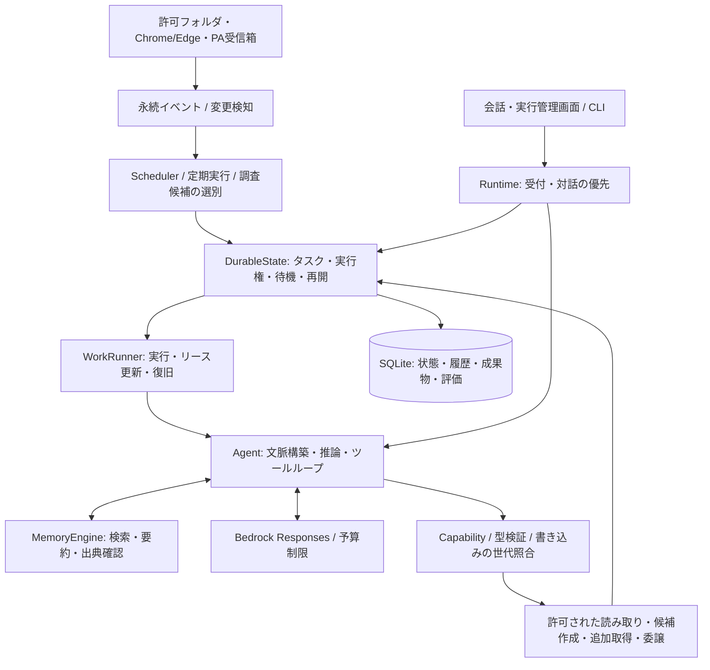
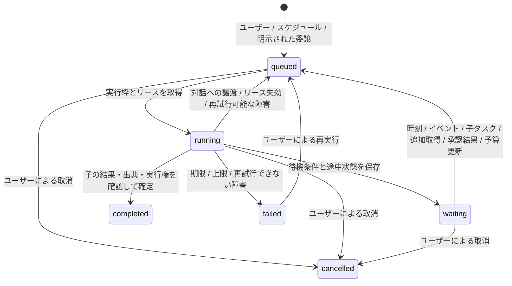

# 継続実行アーキテクチャの評価と実装

2026-10-21 / v0.3.0。v0.2.0には会話・検索・定期確認がありましたが、長期タスクのチェックポイント、プロセス間の実行制御、役割別の記憶、会話の自動要約が不足していました。これらを追加し、通常系だけでなく強制終了・再起動・権限変更・資料改訂を試験しています。

提示されたDots・Grok Bot・OpenClawの解説を、設計要件として比較しました。DotsとGrok Botについては提示文に一次資料のURLがなく、非公開実装との一致は判定していません。OpenClawは下記の固定コミットのコードとドキュメントを確認しました。製品全体の機能互換や、実モデルの回答品質が等しいという評価ではありません。

## 比較結果

| 要件 | v0.2.0 | v0.3.0の実装・検証 |
|---|---|---|
| 会話と独立したタスク | 承認済みタスクの一覧のみ | `work_jobs`に目的・状態・期限・待機条件・実行権・途中状態を保存 |
| 停止と再開 | 会話の中断表示・再試行 | 時刻、子タスク、追加取得、資料変更、承認・却下、日次予算更新による待機・再開。待機中のモデル呼び出しは0回 |
| Durable execution | 監視イベントの簡易claim | モデル出力をツール実行前に保存。ツール結果のreceipt、リース回復、再試行・上限・期限 |
| 同時実行と古い書き込みの拒否 | プロセス内のLock | SQLiteによるセッション単位の実行権、全体の実行枠、期限付きtoken、書き込みトランザクション内の照合 |
| 役割と委譲 | なし | 永続化された役割、専用の記憶、許可ツールと資料/案件範囲。親から子へ権限を縮小して引き継ぐ |
| 結果の統合・成果物 | 会話の最終回答 | 子タスクが終了するまで親は待機し、結果を文脈へ取り込む。出典付きのローカル成果物を版管理 |
| 長期記憶の検索 | 原文引用付きの承認済みメモ | 役割別の知識・出来事・作業手順。FTS5/BM25、任意のローカル埋め込み、RRF・鮮度・重要度・MMR |
| Context compaction | 直近12件に制限 | 古い会話の要約と直近12件。継続タスクは古い推論ラウンドを要約し、直近の呼び出しと結果を対で残す |
| イベント・自動実行 | 限られた定期確認 | 永続化されたタイマー/定期実行/イベント。重複排除、debounce、起動漏れの集約、時計の逆行に依存しないイベント世代 |
| 自発的な調査候補 | 固定候補 | 登録済み案件・予定・承認済み期限・資料変更から候補を作成し、緊急度・価値・通知負担・予算で調査を選別 |
| 権限と承認 | 固定の型付きツール・原文引用 | 明示的なCapabilityと実行範囲。権限変更は委譲先にも適用し、古い文脈と成果物を無効化。AIから設定・承認は変更できない |
| 品質の測定 | 自動テスト | 実行履歴、復旧率、モデル呼び出し/トークン数、役立ち評価、介入率、不要提案率、検索適合率。未評価は`null` |

## 構成

Control planeは受付、永続キュー、スケジュール、役割設定です。Execution planeは推論と許可されたツール実行です。同じWindowsユーザーのローカルプロセスとして動き、SQLiteを共有します。WebSocket Gatewayや公開HTTPサーバーを必要とする設計にはしていません。

| モジュール | 責務 |
|---|---|
| `runtime.py` | 生存期間、収集、対話優先、バックグラウンド実行枠 |
| `state.py` / `state_schema.py` | タスク、リース、役割、イベント、定期実行、成果物、評価の永続化 |
| `execution.py` | 実行権の更新、待機・再開、委譲、結果統合、失敗の処理 |
| `agent.py` | 文脈構築、モデル呼び出し、モデル出力の保存、ツール往復、要約 |
| `memory.py` | 役割別の記憶、ハイブリッド検索、会話要約と出典失効 |
| `policy.py` / `tools.py` | 能力の積集合、資料・案件の範囲、型・引用・実行モードの検証 |
| `scheduler.py` / `opportunities.py` | 明示された目的と新情報からの候補生成、優先順位と起動条件 |
| `ui_work.py` | 継続タスク、待機条件、成果物、定期実行、保存した記憶の操作 |

## タスクの寿命と復旧

モデルの出力を保存してからツールを実行し、結果をreceiptへ保存してから次へ進みます。再起動後は直前の保存位置から再開します。モデルの応答を受信して保存する前に落ちた場合は、推論だけを再実行することがあります。

実行権は45秒、更新は10秒間隔です。同じ物理セッションを同時に取得できません。バックグラウンドは既定2枠、対話用に1枠を確保します。対話が始まるとバックグラウンドはモデル往復・ストリーム・ツール実行の境界で譲ります。停止しても通信が返るまで、または設定されたタイムアウトまで待つ場合があります。

実行権、資料の世代、役割のバージョンを確認します。ローカルの副作用を含むトランザクションでも実行権を照合するため、古い処理は候補や成果物を書けません。権限変更時には子・孫タスクの実行権も失効させ、古い文脈・結果・成果物を破棄します。

追加取得のrequest ID、行動候補のfingerprint、通知キー、子タスクの受付キー、成果物IDを安定させます。**任意の外部APIに対するexactly-once保証ではありません。** 新しい外部書き込みツールを追加する場合は、そのAPI側の冪等キー・照合・結果不明時の手順が必要です。現在はメール送信・任意ファイル変更・Shell・PC操作を提供していません。

タスク期限は既定7日、指定可能な期限は登録時点から30日以内です。自動再試行は最大3回、指数バックオフを使います。継続タスクは既定40モデル往復・100ツール実行を上限とし、日次の全体予算も適用します。処理上限・資料失効の場合は依頼内容を絞って新しく登録します。子は親の範囲内で作り直します。

人の承認が必要な候補は、モデルが承認せずに待機します。承認・却下・候補の失効を確認して再開します。日次予算を使い切ったタスクは失敗として捨てず、次のJST日付での予算更新を待ちます。

委譲は各親から6件まで、親・子・孫の3世代までです。役割自体はユーザーが事前登録します。親は未終了の子を残して完了できず、終了した子の結果を文脈に取り込んでから最終回答を作ります。権限は`親の許可 ∩ 子の設定`です。役割名・IDは委譲時のルーティング情報として共有しますが、他の役割の記憶や設定文を自動注入しません。

## 記憶と文脈

| 種類 | 保存先・利用方法 |
|---|---|
| 現在の作業文脈 | 直近会話、今回の依頼、必要な参照資料、進行中のツール結果 |
| 過去の出来事 | 元の会話履歴のセッション内検索、ユーザーが保存した`episodic`記録 |
| 知識・方針 | `memory_items`の`semantic`記録、原文引用付きで承認した記憶 |
| 継続タスク | `work_jobs`の目的・待機条件・チェックポイント、版付き成果物 |
| 作業手順 | ユーザーが保存した`procedural`記録、役割の設定文、明示的な定期実行 |

記憶は役割のnamespaceで検索します。資料由来の記憶は原文のハッシュ・期限・利用可否を再確認し、資料の許可範囲でも絞ります。ユーザーが直接保存した方針と資料の事実は区別します。モデルに記憶の確定・設定変更の権限は渡しません。

全文検索は既存の日本語二文字索引とFTS5/BM25を使います。任意のローカル埋め込みモデルを設定するとコサイン類似度の候補も取り、RRFで順位を統合します。その後に鮮度・重要度・MMRを適用します。モデルは既存のローカルディレクトリからのみ読み、remote codeとダウンロードを無効にします。未設定・初期化失敗時は全文検索で動作し、状態を区別します。テストの埋め込みは固定ベクトルのfixtureであり、実モデルの検索品質を証明するものではありません。

記憶の上限は既定で役割ごとに1,000件です。意味検索はこの範囲をPythonで走査し、大規模なANNサービスではありません。モデルを入れ替えた場合の再索引は検索ごとに最大64件ずつ進めます。

会話は既定24件以上かつ12,000文字以上の未要約部分があれば、古い部分を最大6,000文字で要約します。直近12件と元の履歴を保持します。継続タスクでは文脈量が上限の85%を超えたとき、古いラウンドを要約し、直近のラウンドは推論出力・呼び出し・結果を対で残します。古い暗号化reasoningを要約用の平文として解釈しません。要約の通信障害時は未要約の範囲を明示して直近の文脈を残し、同じ要約失敗を毎回繰り返さないよう境界を保存します。要約から新しい事実・権限・確定記憶を作りません。

## 自動起動と調査候補

資料の作成・更新と追加取得の完了は、SQLiteのイベントに接続します。同じキーの変更は最新状態へ集約し、資料変更には2秒のdebounceを使います。イベントの世代はDB内の連番で進めるため、時計が逆行しても新旧を判定できます。

定期実行はユーザーが有効にしたものだけ起動します。停止中の10回分を10件まとめて実行せず、未実行分を1回へ集約します。待機中のタスクは推論せず、条件が成立したときに実行待ちへ戻します。

自発的な調査は、登録済みの案件・予定・承認済み期限・新しい会議記録・案件キーワードを使います。価値、緊急度、コスト/リスクの見積り、通知負担で調査を選別し、活動時間・集中モード・日次予算・通知制限をホストが適用します。効用値は明示的なルールであり、ユーザーの意思を学習済みだという説明はしません。原文中の依頼をそのままユーザーの義務にしません。重要でなければ`NO_REPLY`で終了します。

## 資料の変更・失効・保持期間

従来の保守的な失効境界を拡張し、会話要約、資料由来の記憶、途中状態、ツールreceipt、成果物、結果も消します。人が登録した継続タスクの目的は明示的な保存指示として保持します。委譲で生成された子の目的は派生データとして破棄します。

資料が改訂された場合、進行中の親タスクは古い結果を使わず、保存された目的と新しい資料からやり直します。ローカルファイルが変更され再取り込みを待つ間は待機します。アクセス不能・失効の場合は自動継続せず、資料を確認して再登録します。完了済みの成果物も古い原文を含み得るため無効化します。現状は関連するものだけを厳密に追跡する方式より広くキャッシュを消す設計です。

終了した継続タスクと付随データは、終了・更新から`retention_days`経過後の収集/保守で削除します。記憶にも期限を持たせます。定期実行の定義や役割設定、明示的なユーザー指示の保持と、原文キャッシュの保持は区別します。SQLite/WALやバックアップからの物理的な安全消去ではありません。

## 検証と限界

`tests/test_durable.py`では実際に別プロセスを起動し、非同期依頼を書いた直後に`os._exit`で終了します。期限切れの実行権を回復し、依頼ファイルとDBレコードが増えずに続行することを確認します。ほかに複数workerの競合、古いtokenからの副作用拒否、役割間の記憶分離、権限変更の委譲先への適用、時刻/イベント/子タスク/PA待機、会話・作業中の要約、資料更新後の再調査を検証しています。GUIでは登録→実行→結果、待機→取消、定期実行、記憶の追加/削除を実Tkで操作します。

`work metrics`は観測された状態と人の評価から集計します。不要提案率は評価を受けた監視タスクの比率であり、全提案の品質を推定する統計モデルではありません。検索適合率も、人が正解件数・取得件数を記録した場合だけ算出します。未評価の値を0や成功として扱いません。トークン数は実績が取得できない場合に保守的な予約値を含み、金額ではありません。

実Bedrock・社内テナント・実埋め込みモデルでの検索精度・長期利用時の通知品質は未評価です。画面操作からの手順学習、任意のPC/Shell操作、外部チャネル、公開Web Gateway、音声、複数OSユーザーに対する強制隔離は提供していません。永続性は状態の保存と再起動後の復旧を意味します。PCの停止・スリープ中や、常駐プロセスを終了している間に推論することはありません。

## 確認したOpenClawの一次資料

固定コミット: `07f950e4e01b337353a410444bd6c35013aa57c2`（2026-10-21）。設計の参照であり、コードの移植ではありません。

- [セッションと全体の実行枠](https://github.com/openclaw/openclaw/blob/07f950e4e01b337353a410444bd6c35013aa57c2/docs/concepts/queue.md)
- [会話のcompaction](https://github.com/openclaw/openclaw/blob/07f950e4e01b337353a410444bd6c35013aa57c2/docs/concepts/compaction.md)
- [ハイブリッド検索と再ランキング](https://github.com/openclaw/openclaw/blob/07f950e4e01b337353a410444bd6c35013aa57c2/extensions/memory-core/src/memory/hybrid.ts)
- [MMR](https://github.com/openclaw/openclaw/blob/07f950e4e01b337353a410444bd6c35013aa57c2/extensions/memory-core/src/memory/mmr.ts)
- [定期実行の復旧処理](https://github.com/openclaw/openclaw/blob/07f950e4e01b337353a410444bd6c35013aa57c2/src/cron/store/run-recovery.kernel.ts)
