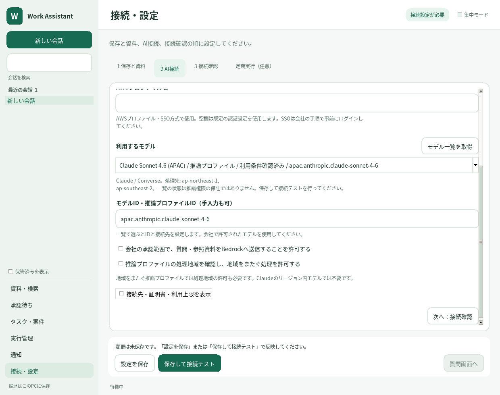

# Bedrockのモデル選択とClaude対応

v0.4.0 / 2026-10-21。Windowsのデスクトップ画面で設定する。

## 操作

1. 「接続・設定 → 2 AI接続」でAWSの地域と認証を設定する。既存のAWSプロファイル・SSO、またはBedrock APIキーの環境変数名を使用する。
2. 「モデル一覧を取得」を押す。未保存の地域・認証でAWSのモデル情報を読み取る。AI推論、利用申込み、設定の保存は行わない。
3. 一覧でモデルを選ぶ。モデルIDと、使用するAPIに合ったRuntime接続先が設定される。処理先の地域も表示される。地域をまたぐプロファイルでは処理地域の許可を確認する。
4. 送信設定を確認し「保存して接続テスト」を押す。短い合成文字列とローカルechoツールによる最大2回の有料推論で、応答とツール往復を確認する。保存後は再起動せず反映される。

図は架空のカタログ応答を使った実Tk画面。実際の会社アカウントでモデルの提供・接続を確認した結果ではない。

一覧取得には `bedrock:ListFoundationModels` と `bedrock:ListInferenceProfiles`、利用条件の確認には `bedrock:GetFoundationModelAvailability` が必要。片方の一覧権限しかない場合も、取得できた結果と未取得の理由を表示する。取得失敗・0件は区別し、再取得とIDの手入力を利用できる。

一覧には、実装が対応するOpenAI系モデルの推論プロファイルとClaude 3以降のテキスト／ツール対応モデル・システム定義プロファイルを表示する。AWSからACTIVEとして返された情報を使用し、モデル名をアプリに固定登録しない。アプリケーション推論プロファイルARN、独自デプロイARN、Nova等の別プロバイダーは対象外。

## 状態の意味

| 表示 | 意味 |
| --- | --- |
| 利用条件確認済み | AWSが返すモデル認可・契約・利用資格・受付地域の状態が利用可能 |
| 利用条件未確認 | 状態確認の権限不足、未対応の状態応答、または受付地域とプロファイル処理先が異なる等。接続テストが必要 |
| 利用不可として除外 | 明示された認可・契約・利用資格の拒否、またはリージョン内モデルの地域非対応 |

カタログ情報は、推論時に評価されるIAM・SCP・各処理先の権限や社内の利用承認を保証しない。受付地域に基本モデルがなくてもクロスリージョンのプロファイルが使える場合があるため、地域非対応だけでそのプロファイルを除外しない。選択後の接続テストを利用する。

地域・認証方式・プロファイル・キーの環境変数名・証明書を変更すると古い一覧を無効にする。取得中は重複操作を抑止し、画面は応答を続ける。結果受信時も接続設定の一致を検証する。APIキー本体や認証情報は一覧・設定ファイルへ保存しない。

## APIと実行基盤

| モデル | API | Runtime接続先の例 |
| --- | --- | --- |
| OpenAI系 | Responses | `https://bedrock-runtime.ap-northeast-1.amazonaws.com/openai/v1` |
| Claude 3以降 | Converse / ConverseStream | `https://bedrock-runtime.ap-northeast-1.amazonaws.com` |

OpenAI系では従来のMantle設定も利用できる。一覧から選ぶ場合はRuntime用のID・接続先を設定する。ClaudeはRuntimeを使う。例として `apac.anthropic.claude-sonnet-4-6` 等を入力できるが、実際に提供されるIDと処理先は対象アカウントの一覧で確認する。対応モデル・地域へ自動でフォールバックしない。

Claudeのテキスト・toolUse・toolResult・使用トークンを内部の共通形式へ変換し、既存の権限制御、引数検証、資料引用、使用量上限、永続タスク・待機・再開・監査を使用する。プロセスをまたいだ再開時もツール呼び出しと結果の対応を復元する。

ストリーミングはAWS Event Streamを使用する。フレーム長、CRC、順序、ブロック終端、メッセージ終端、使用量を検証する。切断・不正JSON・未完了・拒否ではツールを実行しない。リダイレクト、別ホスト、TLS検証の無効化、自動リトライによる推論回数の増幅は行わない。

OpenAI固有の `reasoning.effort` / `encrypted_reasoning` はClaudeへ送らない。Claudeのextended thinkingや画像・音声入力の設定UIは追加していない。返却された署名付きreasoningは継続要求へ保持し、異なるAPIのopaque reasoningは転送しない。ClaudeへResponses固有の `store` や `include` を送らない。会社・AWS側の別のログ設定はこの設定の対象外。

## 完了条件と検証範囲

- 画面で一覧取得 → Claude選択 → 保存 → 再起動なし反映 → OpenAIへの切替を操作できる。
- 一覧取得は推論・保存を行わず、失敗・0件・一部取得・認証変更から回復できる。
- Claudeの合成接続テスト、資料取得・出典付き回答、永続タスクの待機・別Runnerでの再開を通信境界の模擬応答で検証する。
- ストリームの破損・途中切断・未完了・拒否からツール実行を防ぐ。
- 既存の会話・タスク・Chrome/Edge連携の試験を通す。

会社の認証情報はこの開発環境へ接続されていない。実Bedrockモデルの応答品質・提供状況・IAM/SSO/プロキシ・会社の承認は現地の接続テストで確認する。

参照したAWS公式仕様: [Converse](https://docs.aws.amazon.com/bedrock/latest/APIReference/API_runtime_Converse.html)、[ConverseStream](https://docs.aws.amazon.com/bedrock/latest/APIReference/API_runtime_ConverseStream.html)、[ListFoundationModels](https://docs.aws.amazon.com/bedrock/latest/APIReference/API_ListFoundationModels.html)、[ListInferenceProfiles](https://docs.aws.amazon.com/bedrock/latest/APIReference/API_ListInferenceProfiles.html)、[GetFoundationModelAvailability](https://docs.aws.amazon.com/bedrock/latest/APIReference/API_GetFoundationModelAvailability.html)、[APIキーの適用範囲](https://docs.aws.amazon.com/bedrock/latest/userguide/api-keys-use.html)。
