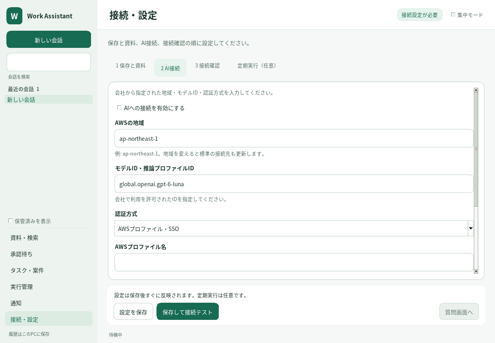

# 会話ワークスペースの使い方

v0.2.0で会話UIを改善し、v0.3.0（2026-10-21）で「継続タスクに登録」と「実行管理」を追加しました。継続タスク・定期実行・記憶の操作は[専用の使い方](DURABLE_WORK.md)を参照してください。ブラウザサーバーの起動や新しいUIライブラリの導入は不要です。

画面の見出し・ボタン・案内は、機能名や操作説明を使います。宣伝文句や比喩的な標語は表示しません。


## 会話を始める

```powershell
.\.venv\Scripts\python.exe -m work_assistant gui
```

左の「新しい会話」で会話を分けます。入力欄は複数行です。Enterは改行、Ctrl+Enterまたは「送信」で送信します。通常の日本語変換確定のEnterでは送信しません。未設定の場合は上部の案内から「接続・設定」へ進めます。設定済み表示は接続成功の証明ではなく、実Bedrockの確認には別途診断が必要です。

入力は1回10,000文字まで。送信できる文字数を超えた下書きも50,000文字まで保持します。会話を切り替えたり終了したりすると下書きを保存し、次回開いたときに戻します。会話ごとに選択した資料も保持します。元資料が更新・失効した場合のリセットは後述のとおりです。

## 資料を指定して質問する

「資料を添える」から取得済みの資料を最大6件選びます。直近のChrome/Edgeキャプチャも選べます。「資料・検索」で資料を選び、「選んだ資料を会話へ」から添えることもできます。ファイルを任意にアップロードする入口ではなく、既存の許可設定で取り込み済みの資料を選ぶ機能です。

質問すると、資料の鮮度と利用可否を再確認し、文脈量に応じて本文の先頭最大4,000文字を参照データとして渡します。モデルは必要に応じて原文の続きを読むツールを使えます。資料の文章をユーザー指示へ変換せず、参照データとして扱います。添えた資料は「×」で外せます。過去の質問にも添えた資料を表示します。

回答の出典は［1］などの番号と資料名で表示します。資料名を押すと、再確認した原文・取得時刻・確認期限を別ウィンドウで読めます。「コピー」は回答に資料名と出典URLを添えてコピーします。見出し・太字・箇条書き・コードの基本表示に対応し、HTMLや任意のリンク先を実行しません。長いメッセージは折りたたんで表示できます。

## 応答中・停止・失敗

- 生成中のテキストは「生成中・未確定」と表示します。検索や原文確認の進捗は日本語で表示します。完了後は必要に応じて「確認の手順」を開けます。
- 「停止」またはEscで停止を要求します。次のストリーム受信・モデル往復の境界で中止します。通信が応答しない間は、設定された通信タイムアウトまで待つ場合があります。HTTPリクエストを常に即座に強制切断する機能ではありません。
- 停止・失敗した途中出力は確定した回答として保存しません。「もう一度」で同じ質問を重複登録せず再実行でき、「質問を編集」で下書きへ戻せます。原因に応じて接続・設定などの案内を表示します。
- 応答中も別の会話を開いて下書きを編集できます。返答は依頼元の会話に保存し、現在の別会話へ混ぜません。モデルへの同時送信は1件です。
- 過去の回答を読んで上へスクロールしたときは、生成中に自動で一番下へ戻しません。「最新のメッセージへ」で戻れます。

## 初期設定と資料の追加

未設定なら「接続・設定」を開いて起動します。ローカル保存の許可、資料フォルダ、AI接続をフォームで設定できます。認証方式を選ぶと、その方式に必要な入力欄を表示します。認証キー本体は入力せず、既存のAWSプロファイル/SSOまたは環境変数を使用します。

「保存して接続テスト」はテスト用の文字列で最大2回推論し、応答とツール呼び出しを確認します。業務資料と会話履歴は送信しません。「設定済み」と「接続確認成功」は区別し、接続設定を変えた場合は古い成功結果を使いません。テスト中も画面操作は応答し、設定の二重保存は抑制します。

「資料を追加」はファイル選択です。許可したフォルダ内の対応ファイルだけを取り込み、質問へ最大6件添えます。許可フォルダが未設定なら設定画面へ案内します。許可外・認証情報・アプリ保存先の取り込みは拒否します。取得済み資料の選択画面には資料0件の案内と追加・取消を表示し、確定ボタンを固定表示します。



初期設定の合格条件と限界は[完了条件](SETUP_ACCEPTANCE.md)に記載しています。

## 明るいデスクトップUI（v0.3.2）

サイドバーと作業領域を明るくし、会話・入力欄・操作ボタン・表・設定タブを共通の角丸部品に変更しました。主操作、補助操作、選択中、無効、キーボードフォーカスを区別します。「継続タスクに登録」は送信欄の下に分け、小画面でも送信・停止・資料添付を操作できます。機能名と具体的な説明を用い、宣伝的な文言は表示しません。

標準のTk部品を角丸の面で囲む構成です。ボタンのEnter/Tab、端のクリック、無効時の実行抑止、日本語入力と文字選択を検証します。追加ライブラリ・Webサーバー・フォントのダウンロードは不要です。詳しくは[UIデザイン](UI_DESIGN.md)を参照してください。

## 会話の管理

左の検索は会話名と発言内容を検索します。名前変更、保管、保管済み一覧からの復元ができます。保管はデータ削除ではありません。再起動時には最後に開いた会話と下書き・選択資料を復元します。画面には直近200件のメッセージを表示し、Agentは直近12件に加え、条件を満たす長い会話の要約を文脈として使います。過去の発言は会話ごとの検索ツールで参照でき、別の会話の履歴を混ぜません。

| 操作 | ショートカット |
|---|---|
| 改行 | Enter |
| 送信 | Ctrl+Enter |
| 新しい会話 | Ctrl+N |
| 会話の入力欄へ | Ctrl+L |
| 停止要求 | Esc |

## 既存データとの互換性

既存の会話履歴は初回起動時に会話一覧へ移行します。v0.3.0ではSQLiteのschema versionを3へ更新し、元の会話・下書き・選択資料を保持します。更新前はアプリを終了し、必要なバックアップは会社のデータ保持手順に従って行ってください。旧版で新しいDBを開く運用はサポートしません。

元資料が改訂・失効した際に会話キャッシュを保守的に消す従来の境界は維持しています。新設した会話名・下書き・選択資料・出典メタデータもリセットし、遅れて届いた古い画面イベントや保存処理から復活させません。画面にもリセットの理由を表示します。異常終了した実行中の依頼は、次回起動時に中断として表示し、再実行できます。

## OpenClawとの対応

参照は`openclaw/openclaw`の固定コミット`72d41b6f9d0bd2290a959f062b134f60664063d7`。操作の設計を参考にした独立実装です。

| 参照した操作 | 本アプリの実装 | 参照ソース |
|---|---|---|
| 会話一覧・名前変更・保管 | Sidebar、SQLite会話メタデータ | [session-menu-actions.ts](https://github.com/openclaw/openclaw/blob/72d41b6f9d0bd2290a959f062b134f60664063d7/ui/src/components/session-menu-actions.ts) |
| 複数行入力・ショートカット・IMEへの配慮・停止 | Tk Text、Ctrl+Enter、Esc | [chat-composer-keydown.ts](https://github.com/openclaw/openclaw/blob/72d41b6f9d0bd2290a959f062b134f60664063d7/ui/src/pages/chat/components/chat-composer-keydown.ts) |
| 下書きの扱い | 会話別の下書きと添付ID、再起動時の復元 | [composer-draft.ts](https://github.com/openclaw/openclaw/blob/72d41b6f9d0bd2290a959f062b134f60664063d7/ui/src/pages/chat/composer-draft.ts) |
| 読み取り・生成中の表示 | リクエスト別イベント、未確定応答と進捗 | [chat-message-stream-view.tsx](https://github.com/openclaw/openclaw/blob/72d41b6f9d0bd2290a959f062b134f60664063d7/ui/src/pages/chat/components/chat-message-stream-view.tsx) |

OpenClawの全機能・プラグイン・外部チャネル・マルチエージェント・音声・スマホ/Web UIの互換実装ではありません。v0.3.1では初期設定フォーム、明示操作による接続テスト、許可フォルダ内の資料取り込みを追加しました。初回は「保存と資料 → AI接続 → 接続確認」の順に進め、保存後は同じアプリに再起動なしで反映します。高度な連携項目には引き続き設定ファイルを使います。

## 検証

現行の件数は[検証記録](TEST_REPORT.md)を参照してください。実Tk操作試験で、改行/送信、会話切替、下書き/履歴の復元、添付、原文、コピー、保管/復元、停止、再実行、応答中の会話切替、オフライン診断、失効時の表示を検証します。画面例は架空データとモックの応答で作成し、実Bedrockの動作確認とは区別します。

```powershell
# Windowsで実GUI試験
$env:WORK_ASSISTANT_UI_TESTS = '1'
python -m unittest discover -s tests -p test_ui.py -v
```

Linuxでは`WORK_ASSISTANT_UI_TESTS=1 xvfb-run -a python -m unittest discover -s tests -p test_ui.py -v`。Tk8.6以上と日本語表示可能なフォントを使います。GitHub ActionsではWindows/Linux・Python3.11/3.13の4構成で実行します。会社PCのIME・DPI設定・実Bedrockでの最終確認は別途必要です。
