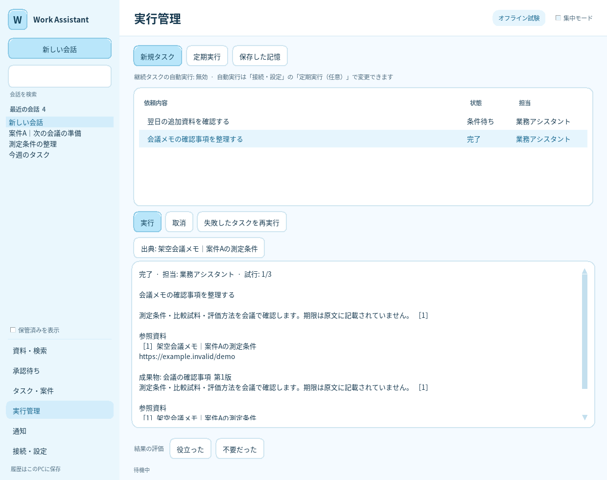

# 継続タスク・定期実行・保存した記憶

v0.3.0。構造の評価と障害時の動作は[アーキテクチャ評価](ARCHITECTURE_REVIEW.md)を参照してください。

## 画面から使う



会話の入力欄へ依頼を書き、「継続タスクに登録」を押します。選択した取得済み資料も引き継ぎます。会話の「送信」は通常の1回の対話、継続タスクの登録は待機・再開を含む仕事の受付です。

左の「実行管理」で、実行待ち・実行中・条件待ち・完了・失敗・取消を確認します。「実行」で手動実行し、「取消」で親と実行中の子を取り消せます。終了結果と版付きの成果物、原文への出典ボタンを表示します。失敗した親タスクは原因に応じて再実行できます。処理上限や資料失効の場合は、内容と資料を見直して新しく登録してください。

「定期実行」では名前・依頼・間隔を登録し、有効/無効を切り替えます。「保存した記憶」では担当ごとの知識・方針を追加・削除します。元資料の内容を保存したい場合は、引用付きの「承認待ち」から確定する方法を使うと原文の失効に追従できます。

継続タスクが承認待ちになった場合は、「承認待ち」で原文と候補を確認して承認・却下します。日次予算を使い切った場合は、予算更新待ちとして保存し、次のJST日付から続行します。待機中にモデルを呼び続けることはありません。

## 自動実行を有効にする

初期状態では自動実行は無効です。「接続・設定」で利用範囲とBedrockの設定を確認し、「定期実行（任意）」の「保存した継続タスク・定期実行を自動で実行する」を選んで保存します。同じアプリには再起動なしで反映します。設定ファイルで変更する場合の対応項目は次のとおりです。

```json
{
  "durable_work_enabled": true,
  "background_workers": 2
}
```

これは設定の該当項目だけの例です。既存の設定ファイル全体を置き換えないでください。定期確認の`heartbeat_enabled`とは別の設定です。定期確認だけを有効にした場合、通常の継続タスクや登録済みの定期実行は自動起動しません。

GUIを開くか、CLIで`python -m work_assistant run`を起動している間に動きます。GUIを閉じると、そのGUI内の常駐処理も終了します。再起動後は保存された待機条件と途中状態から続行します。同じユーザー・同じ保存先を使う別プロセスとの整合性はDBで制御しますが、共有ネットワークドライブや複数ユーザー向けサーバーとしては使いません。

## CLI

```powershell
# 登録と確認
python -m work_assistant work add "会議資料を確認し、追加情報が届いたら内容を再確認する" --key meeting-review-1
python -m work_assistant work list
python -m work_assistant work show <job_id>

# 1件の明示的な手動実行 / 取消 / 再実行
python -m work_assistant work run-next
python -m work_assistant work cancel <job_id>
python -m work_assistant work retry <job_id>

# 評価を記録し、観測値を確認
python -m work_assistant work feedback <job_id> --helpful --relevant 2 --retrieved 3
python -m work_assistant work metrics
```

`work add`には`--agent`、複数の`--document`、`--at`、`--deadline`を指定できます。時刻は`2026-10-22T09:00:00+09:00`のようにタイムゾーン付きで指定します。同じ`--key`と同じ依頼は二重登録せず、同じキーで違う内容を送ると拒否します。明示的な手動実行でも、実Bedrockの送信設定と全体予算は適用します。

## 役割と記憶

```powershell
# 調査担当を作成。資料・案件を空にすると、その範囲の読み取りを許可しません。
python -m work_assistant role set research "資料調査" --instructions "確認できた根拠と不明点を整理する" --documents "" --projects ""
python -m work_assistant role list

# 特定資料を許可する場合はrole setの--documentsにIDを列挙します。
# 作業手順はユーザーが明示的に保存できます。
python -m work_assistant memory add "週次報告では測定条件、評価方法、未確認事項の順で確認する" --agent research --kind procedural
python -m work_assistant memory search "週次報告" --agent research
python -m work_assistant memory forget <memory_id> --agent research
```

`--documents`や`--projects`を省略した設定は、取り込み済みの全範囲を許可します。空文字は許可範囲を空にします。`--tools`を省略した新しい役割は読み取り用です。許可するツールを変える場合はカンマ区切りで指定します。モデルに役割設定・承認の変更ツールはありません。役割の権限や設定文を変更すると、その役割と委譲先の古い実行・結果を無効化します。

役割の記憶は会話スレッドとは別に保存されます。通常の会話履歴検索は同じセッション内です。ユーザーが保存する`semantic`・`episodic`・`procedural`の記録を、モデルの重みの学習やPC操作の自動学習と同一視しません。

## 定期実行・イベント起動

```powershell
# 既定は無効で登録し、明示的に有効にする
python -m work_assistant routine add "毎時の資料確認" "取得済み資料から重要な変更を確認する" --every-minutes 60
python -m work_assistant routine enable <routine_id>
python -m work_assistant routine disable <routine_id>
python -m work_assistant routine list

# 1回の時刻指定 / 特定資料の変更
python -m work_assistant routine add "会議前確認" "会議の確認事項を整理する" --at "2026-10-22T08:30:00+09:00" --enabled
python -m work_assistant routine add "資料更新確認" "変更された資料を確認する" --event document --event-key <document_id> --enabled
```

保存した定期実行は、自動実行を有効にして常駐している間に起動します。定期確認は活動時間と通知抑制を適用します。ユーザーが明示した通常タスクの時刻・間隔は、その指定に従います。通知ツールは監視用の実行モードにだけ渡します。

## ローカルの意味検索を使う場合

```powershell
python -m pip install ".[semantic]"
```

審査・配布済みのローカル埋め込みモデルのディレクトリを`memory_embedding_model`へ設定し、再起動します。モデルの自動ダウンロードは行いません。未設定なら全文検索が使えます。`max_memory_items`は役割ごとの上限で、既定1,000件です。設定変更時の再索引は分割して進めます。`HF_HUB_OFFLINE`・`TRANSFORMERS_OFFLINE`・`HF_HUB_DISABLE_TELEMETRY`を有効にし、`local_files_only`と`trust_remote_code=False`で読み込みます。

## 更新とバックアップ

v0.3.0はSQLiteのschemaを2から3へ更新します。既存の会話、下書き、選択資料、承認済みタスクを残します。更新前には全てのアプリ・常駐プロセスを終了し、会社の保存手順に従って保存先をバックアップしてください。新しいDBを旧版で開く運用はサポートしません。設定ファイルのschemaは1のままで、追加項目には既定値を使います。
